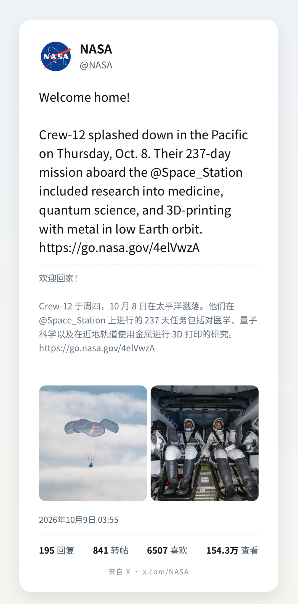
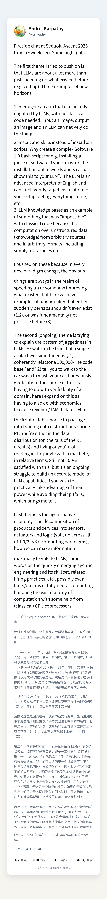

# 推特转图 (Tweet to Image)

一个iOS快捷指令，将X/Twitter帖子转换为精美的分享图片，支持中文翻译和三种视觉风格。

## 功能特性

- 📱 **一键转换**：从分享菜单或剪贴板直接转换Twitter/X链接为图片
- 🌐 **自动翻译**：集成中文翻译（基于FxTwitter API）
- 🎨 **三种风格**：浅色、深色、纸感三种视觉主题可选
- 🖼️ **媒体支持**：支持1-4张图片和视频缩略图，自动布局
- 📐 **完美尺寸**：输出1080px宽度，适合社交媒体分享
- ⚡ **完全离线**：生成过程在本地完成，无需额外服务

## 预览

### 风格展示

**浅色风格**


**深色风格**


**纸感风格**


### 媒体布局

**单图**


**双图**



**长文**



**视频**


## 安装

1. 在iPhone或Mac上下载 `shortcut/推特转图-signed.shortcut` 文件
2. 打开文件，iOS会自动启动快捷指令App
3. 点击「添加快捷指令」完成安装

**注意**：已签名版本可直接导入，无需额外操作。

## 使用方法

1. 在Twitter/X App中，找到想要分享的帖子
2. 点击分享按钮，选择「推特转图」
3. 在弹出的菜单中选择风格：
   - **浅色**：明亮清新的渐变背景
   - **深色**：暗色调科技感风格
   - **纸感**：温暖的纸质纹理
4. 等待几秒，图片将自动保存到相册

也可以：
- 复制推文链接后直接运行快捷指令（会自动从剪贴板读取）
- 从分享菜单选择快捷指令

## 工作原理

### 数据获取

1. **提取推文ID**：从输入的URL中正则匹配推文ID（支持 `x.com` 和 `twitter.com`）
2. **调用API**：访问 `https://api.fxtwitter.com/status/{id}/zh` 获取推文数据
3. **重试机制**：如果首次请求翻译为空，等待2秒后重试（FxTwitter的翻译有时需要时间生成）

### 卡片生成

1. **HTML构建**：将推文内容（文本、作者、媒体、统计数据）填充到HTML模板
2. **样式应用**：根据选择的风格设置配色和背景
3. **内嵌资源**：头像和图片转为Base64内嵌（避免PDF生成时网络加载问题）
4. **PDF转换**：使用「制作PDF」动作将HTML转为PDF
5. **图片提取**：从PDF提取页面图像并拼接
6. **尺寸调整**：缩放到宽度1080px，裁剪到计算的高度

### 高度计算

根据文本长度和媒体内容自动计算卡片高度：

- 短推文（单页）：1440px，带垂直居中
- 长推文（多页）：自动扩展，每页1397px + 40px分页余量
- 公式：`0.965 × (680 + 中文行高 + 英文行高 + 换行高度 + 翻译高度 + 60) + 媒体高度`

## iOS快捷指令开发要点

在开发这个快捷指令时遇到的关键技术问题和解决方案：

### PDF生成

- **问题**：iOS的「制作PDF」动作会忽略CSS `@page` 尺寸设置，默认输出Letter尺寸（612×792pt）
- **解决**：通过后续的「调整图像大小」和「裁剪图像」步骤强制调整到目标尺寸

### CSS背景

- **问题**：PDF生成时CSS背景色和渐变会被完全丢弃
- **解决**：将背景渐变预先生成为PNG图片，用 `` 标签嵌入（36×48px的小图拉伸）

### 垂直居中

- **短推文**：body高度1397px + 顶部padding 103px = 垂直居中效果
- **长推文**：body高度等于计算的总高度，顶部padding固定60px，每个分页点增加40px余量

### 条件判断

- **问题**：「如果」动作比较参数时，如果传入文本类型的数字，会弹出「请为每个参数选择一个值」
- **解决**：使用「计算」动作加0（如 `值+0`）将文本强制转换为数字类型

### 文本动作

- **避免使用 `+` 拼接**：在「文本」动作中使用 `+` 号会被解析为字面字符
- **使用变量药丸**：直接插入变量到文本框中，系统会自动处理连接

### 词典取值

- **使用单键查询**：用 `getvalueforkey` 直接获取单个键，不要用复杂的key path表达式
- **嵌套访问**：逐级获取，如先取 `tweet`，再从结果取 `author`

## 媒体布局

### 单图
- 宽度：796px
- 高度：按比例缩放，最高1200px
- 居中显示

### 双图
- 并排布局
- 每图高度：460px
- 间距：12px

### 三图（X风格）
- 左侧一大图（772px高，跨2行）
- 右侧两小图（各380px高）
- 网格布局

### 四图
- 2×2网格
- 每图380px高
- 间距：12px

### 视频
- 显示缩略图
- 中央半透明播放按钮覆层

## 版本历史

### v1 → v13
- v1: 基础功能，URL识别
- v2-v4: 添加相册保存
- v5: 添加空白图片占位
- v6-v7: 实现翻译重试机制（2秒延迟）
- v8-v9: 自动高度计算
- v10: 单推文垂直居中
- v11-v12: 媒体支持（图片和视频）

### v13
- 尝试使用SVG背景（失败，iOS渲染问题）
- 回退到PNG背景方案

### v14
- 修复数字比较问题（文本转数字）
- 清理调试代码

### v14.1（当前版本）
- **重大变更**：将风格选择菜单移到数据获取之后
- **原因**：在v14中发现，如果菜单放在API请求之前，翻译会神秘消失
- **动作数**：185个动作
- **文件大小**：约35KB（未签名），40KB（已签名）

## 构建与签名

### 生成快捷指令

```bash
cd src
python build_shortcut.py
```

这会在 `shortcut/` 目录生成 `推特转图.shortcut` 文件（每次运行UUID会变化，但功能相同）。

### 签名（需要macOS）

```bash
shortcuts sign --mode anyone \
  --input shortcut/推特转图.shortcut \
  --output shortcut/推特转图-signed.shortcut
```

**说明**：
- 从iOS 15开始，导入的快捷指令必须经过签名
- `shortcuts` 命令仅在macOS 12+可用
- `--mode anyone` 允许任何人使用该快捷指令

### 依赖

- Python 3.7+
- Pillow（用于生成风格背景图片）：`pip install Pillow`

## Linux预览

虽然快捷指令只能在iOS/macOS运行，但可以在Linux上预览渲染效果：

```bash
cd src
# 使用示例数据生成HTML
python fill.py ../samples/data.json filled.html 0 light

# 使用Chrome无头模式截图
google-chrome --headless=new --no-sandbox --disable-gpu \
  --window-size=1080,1440 \
  --screenshot=output.png \
  file://$(pwd)/filled.html
```

**脚本**：
- `fill.py`：填充模板生成HTML
- `render.sh`：自动渲染脚本（需要Chrome）
- `emu_html.sh`, `wk.py`：其他渲染辅助工具

## 已知限制

1. **多页边距**：长推文的分页边距计算可能有20-60px误差（与实际渲染相关）
2. **第三方依赖**：依赖FxTwitter API服务的可用性和稳定性
3. **翻译延迟**：有时需要重试才能获取翻译（已内置2秒重试）
4. **Letter分页**：iOS的Make PDF会强制使用Letter尺寸分页，需要手动裁剪
5. **未来方向**：理想方案是开发原生SwiftUI应用，使用ImageRenderer直接渲染，避免PDF中间步骤

## 技术栈

- **快捷指令版本**：v14.1（185个动作）
- **最低iOS版本**：iOS 15（需要签名支持）
- **API**：FxTwitter Public API
- **渲染**：HTML + WebKit + PDF
- **语言**：中文（简体）

## 许可证

MIT License - 详见 [LICENSE](LICENSE)

## 致谢

- [FxTwitter](https://github.com/FixTweet/FxTwitter) - 提供推文数据和翻译API
- 风格配色参考了现代设计趋势

## 贡献

欢迎提交Issue和Pull Request！

主要目录：
- `shortcut/` - 快捷指令文件（签名和未签名）
- `src/` - Python构建脚本和HTML模板
- `samples/` - 示例API响应数据（用于测试）
- `previews/` - 各种风格和布局的预览图
- `legacy/v13/` - v13版本备份

---

**作者**: iampennyli  
**版本**: v14.1  
**更新**: 2026-10
